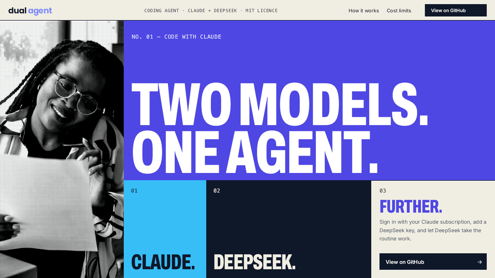

# Dual Agent (Claude + DeepSeek)

[](https://github.com/FreyAI/dual-agent/actions/workflows/ci.yml)
[](LICENSE)


**Progress to 1.0**


> **Beta (0.9.0).** Dual Agent works and is in daily use, but we're still finding and fixing bugs. It runs and is tested on **macOS**; tests on **Windows** and **Linux** are still pending. If something breaks or looks wrong, please [report it](https://github.com/FreyAI/dual-agent/issues/new/choose). Every report helps.

Dual Agent is a VS Code chat panel for Claude Code that also runs on DeepSeek, and splits work between them to cut cost. Both providers run the same agent (Anthropic's Claude Agent SDK), so tools, helper agents, permissions and project memory work the same way on either. In **Auto** mode the two take turns through the day, and a task that struggles moves up to the stronger model. When one provider fails, the chat carries on with the other.

<!-- TODO: record the shots in docs/media/SHOTLIST.md and drop them in docs/media/ -->


## What it does

- **Two providers, one chat.** Claude through your claude.ai sign-in or an Anthropic key, and DeepSeek on your DeepSeek key. Switch at any time; the chat continues where it was.
- **Auto mode shares the work.** Claude and DeepSeek split each day's tokens to a target you set (50/50 by default).
- **Helper agents** run on the cheaper model: a searcher, a quick helper, a deep thinker and a general-purpose agent.
- **Stays honest.** Reports are checked against what the agent did; a claim its work doesn't show gets *not verified*.
- **Guards against loops and hidden failures**, and one build or test at a time per repo.
- **Project memory** in plain Markdown, so each agent doesn't learn the same thing twice.
- **Token savings from the start:** older tool output is cleared, tool output is trimmed, chats compact earlier, and replies can be terse.
- **Cost tracking:** tokens and cost in the chat, a spend limit, a daily budget and per-model limits.
- **Optional:** web search, Remote Control from the Claude app on your phone, and a Mac dictation mic.

## Install

Dual Agent isn't on the Marketplace yet. Clone it and install it into VS Code on your Mac:

```sh
git clone https://github.com/FreyAI/dual-agent.git
cd dual-agent
npm ci
make install
```

`make install` builds the extension for your Mac, runs the tests, and installs it into every VS Code-family editor it finds (VS Code, Insiders, VSCodium, Cursor, Windsurf). Reload the VS Code window afterwards. To update, run `git pull` and `make install` again; `make uninstall` removes it.

Windows and Linux have installers too, but they haven't been tested yet. See [install/INSTALL.md](install/INSTALL.md).

**Requirements:**

- macOS, with Node.js 18 or later and npm (for example `brew install node`). The Xcode Command Line Tools are optional; without them the chat has no dictation mic.
- VS Code 1.90 or later.
- A Claude account for the claude.ai sign-in, or an Anthropic API key.
- A DeepSeek API key for the DeepSeek side. Either provider alone is enough; with both you get Auto mode.

## Quickstart

1. Open a folder, then click the Dual Agent icon in the Activity Bar.
2. The first chat asks for setup. Click **Sign in to Claude** (or skip it with an Anthropic key), and **Set DeepSeek API Key** on the DeepSeek side.
3. Pick a mode from the model pill in the top bar: **Auto** shares work between both; **Claude** or **DeepSeek** uses one.
4. Type a task and press **Enter**. Commands and edits ask first in *Ask* mode; read-only commands run on their own.
5. The line under each reply shows who answered, what it cost, and whether its claims check out. Click the token count for [usage](docs/usage-records.md).

## Provider configuration

Run **Dual Agent: Sign In to Claude** (or **Set Anthropic API Key**), and **Dual Agent: Set DeepSeek Key**. The keys are stored in VS Code's secret storage. The credentials file option: `dualAgent.deepseek.apiKeyFile` points at a `.env`-style file (for example `credentials/deepseek.env`) holding `DEEPSEEK_API_KEY=…`, `BRAVE_API_KEY=…`, `TAVILY_API_KEY=…` or `GITHUB_TOKEN=…`.

| Setting | Default | What it does |
|---|---|---|
| `dualAgent.mode` | `auto` | `auto`, `claude` or `deepseek` |
| `dualAgent.tokenSplit` | `50` | Claude's share of tokens in auto mode, 0–100 (the rest goes to DeepSeek); `null` turns the split off |
| `dualAgent.claude.model` | empty | Claude model; empty uses your Claude Code default |
| `dualAgent.claude.thinkingEffort` | `medium` | How hard Claude thinks at Thinking effort; `medium`, `high` or `xhigh` |
| `dualAgent.deepseek.model` | empty | DeepSeek model for Thinking and planning; empty uses the newest Pro model DeepSeek lists |
| `dualAgent.deepseek.fastModel` | empty | DeepSeek model for Flash, helpers and background work; empty uses the newest Flash model |
| `dualAgent.deepseek.baseUrl` | `https://api.deepseek.com/anthropic` | DeepSeek's Anthropic-compatible endpoint |
| `dualAgent.claudeRole` | `backup` | What auto mode uses Claude for when the split is off: `backup`, `primary` or `off` |

The full list, with descriptions, is in [docs/settings.md](docs/settings.md).

## Token balancing

Most coding work doesn't need the strongest model. Dual Agent sends each task to the cheapest model that can do it and keeps the expensive one for work that needs it:

- **By task type.** Quick mechanical edits go to DeepSeek Flash, ordinary coding to DeepSeek V4 Pro. Hard work goes to Claude when `dualAgent.claudeRole` is `primary`. Helper agents (search, summaries, mechanical edits) run on the cheaper model.
- **By budget.** `dualAgent.tokenSplit` sets Claude's target share of the day's tokens. The providers take turns in stints, switching only between tasks.
- **On trouble.** A task that keeps failing checks moves up a level: Flash, then V4 Pro, then Claude.
- **On rate limits.** When a provider is down or out of quota, the chat continues on the other one for `dualAgent.fallbackCooldownMinutes`.

Details: [docs/token-balancing.md](docs/token-balancing.md#the-split-auto).

### Measured cost

46 runs of the built-in eval: 8 tasks with hidden tests, 3 of them hard, 1–2 runs per task and arm. Full table, method and raw data: [docs/benchmarks/2026-10-25.md](docs/benchmarks/2026-10-25.md).

| Arm | Passed | Cost per run | Cost per solved task | Time per run |
|---|---|---|---|---|
| All-Claude | 13/15 (87%) | $0.293 | $0.338 | 0.7 min |
| All-DeepSeek (V4 Pro) | 14/15 (93%) | $0.030 | $0.032 | 1.4 min |
| Auto, 50/50 split | 15/16 (94%) | $0.027 | $0.028 | 1.3 min |

- **DeepSeek solved these tasks for about a tenth of Claude's cost**, and passed one more run (14/15 against 13/15). Claude's cost is the API price; on a Claude subscription you pay a flat fee instead.
- **Routing hard tasks to Claude would not have paid off here.** Computed from the same runs (not a separate run): Claude on the 3 hard tasks and DeepSeek on the rest passes 12/15 at $0.154 per solved task. That is about 5× all-DeepSeek's cost, for fewer passes, because Claude failed `hard-cross-module` both times.
- **The Auto arm ran almost entirely on DeepSeek.** Under a split, a new task goes to whichever provider's stint it is, and here that was DeepSeek's. So it shows the split working as a budget, not routing by task type, which wasn't measured.

### Where DeepSeek falls short

- **Concurrency:** it fixed a race condition in only 1 of 2 runs (in each arm that used it), and reported success both times. Claude fixed it in 2 of 2 runs.
- **Speed on hard tasks:** on `hard-cross-module` it took 7 minutes to Claude's 1. It got there, but slowly.
- **Long context:** the fixtures are small repositories, so large codebases and long sessions are untested. That is where DeepSeek is expected to fall short, and where the escalation to Claude and the split are meant to help.

Treat these as small-sample figures (one run can flip a task). Run `npm run eval` on your own tasks before relying on them.

## Cost controls

- **`dualAgent.costLimitUsd`** stops per-token spending at a dollar amount since the last reset: the running reply stops, and no new reply starts until **Dual Agent: Reset Cost Limits**. A warning comes at 80%.
- **`dualAgent.dailyBudgetUsd`** stops new replies once today's per-token spend reaches the amount.
- **`dualAgent.modelCostLimitsUsd`** sets limits per model, for example `{ "claude-opus": 20, "deepseek-v4-pro": 5 }`; another model answers when one reaches its limit.
- **`dualAgent.showCostInChat`** shows the chat's cost next to the token count in the message box (off by default; the token pill's tooltip and the usage panel always show it).
- Subscription use isn't counted by any of these limits. The **Cost** tab of the usage panel sets them without editing settings.

## Docs

- [Usage](docs/usage.md): the chat, permissions, helper agents, project memory and guards.
- [Token balancing](docs/token-balancing.md#the-split-auto): how Auto mode splits the work.
- [Settings](docs/settings.md): every setting with its default.
- [Speed and token use](docs/performance.md): what keeps replies fast and calls small.
- [Build modes](docs/build-modes.md), [Web search](docs/web-search.md), [Remote Control](docs/remote-control.md).
- [Usage, metrics and logs](docs/usage-records.md): what's recorded and where to look.
- [How it works](docs/architecture.md): the proxy between Claude Code and DeepSeek.
- [Working on the code and tests](docs/development.md), [MODELS.md](MODELS.md).
- [CONTRIBUTING.md](CONTRIBUTING.md), [SECURITY.md](SECURITY.md).

## License

MIT. See [LICENSE](LICENSE).
